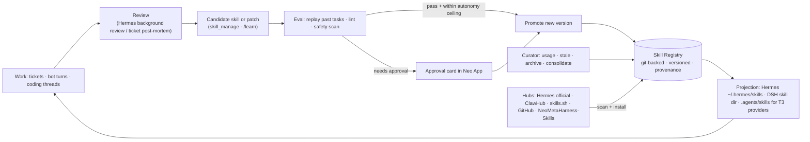

# 02 · Architecture

Status: draft v0.2 · 2026-11-17 · supersedes v0.1

## 0. Principles

1. **Stand on giants.** The *backends* come from DeepSeek Harness (DSH) and Hermes Agent, unmodified. The *usability* comes from T3 Code and bot-hq. Neo writes glue, UI and the missing pieces, never a second copy of an engine.
2. **Everything is an extension.** Engines, channels, computers, models, memory, skills, UI pages and themes are all extensions. Any of them can be installed, upgraded, switched on or off, or removed without breaking the rest ([05 Extension System](05-extension-system.md)).
3. **Agnostic by default.** Every external dependency sits behind an interface that has, or plans, at least two implementations: models, subscriptions, computers, channels, memory stores, databases, coding agents, even engines. We prefer **open protocols** over products: MCP, ACP, OpenAI-compatible APIs, agentskills.io `SKILL.md`, RFB/VNC, CDP, OpenTelemetry.
4. **One product, one design.** A single Neo App built on **Astryx** (React 19 + StyleX, themes as CSS variables). No upstream UI is embedded. We reuse their headless clients and their UX patterns.
5. **Upstream-safe.** Engines are consumed through documented seams and pinned versions, and bumps are tested locally. bot-hq is the one exception: it is **adopted as first-party code**.
6. **Learns over time.** The learned-skills loop (Hermes) and the decision traces (super agent) are core features, not add-ons.

## 1. System overview

```mermaid
flowchart TB
  subgraph Clients["Neo App — one Astryx UI"]
    D["Desktop (Tauri 2 · OS webview)"]
    W["Web"]
    P["Phone (PWA)"]
  end
  subgraph GW["Neo Gateway (TS) — extension host"]
    K["Kernel: extension lifecycle · permissions · settings · vault · event bus"]
    API["Neo API (RPC + streaming)"]
    AUTH["Workspaces · members · roles"]
    AG["Agents service (adopted bot-hq)<br/>bots · rooms · routines · tasks · library · approvals · voice"]
    REG["Capability registries<br/>Computers · Channels · Models · Skills · Memory · Tools · Sources"]
  end
  subgraph Engines["Engines — unmodified upstream, each wrapped by an engine extension"]
    SA["Super agent<br/>DSH + dsh-superagent bundle"]
    DSH["DeepSeek Harness<br/>(coding runtime, ACP/SDK)"]
    HER["Hermes Agent<br/>(agents · skills · channels · cron · screens)"]
    T3["T3 Code server<br/>(threads · providers · git · worktrees)"]
  end
  subgraph Mem["Memory"]
    L1[("Neo Local Memory · L1")]
    L2[("Honcho · L2")]
  end
  subgraph Comp["Computers — any provider"]
    C1["Hermes Bot Screen (any Linux / sandbox)"]
    C2["Your desktop (cua-driver)"]
    C3["Docker / VNC / SSH"]
    C4["Orgo · E2B · Daytona · box · …"]
  end
  Clients --> API
  API --> K & AUTH & AG & REG
  K --> SA & DSH & HER & T3
  T3 -->|ACP| DSH
  SA -->|MCP| T3
  SA -->|Neo API / MCP| AG
  AG -->|/v1 API · dashboard API| HER
  HER & DSH & SA --> L1
  L1 <--> L2
  REG --> Comp
  HER & DSH -->|computer / browser seams| Comp
```



## 2. Layers

| Layer | What | Tech (swappable) |
|---|---|---|
| **Clients** | Neo App: one codebase for web, PWA and the desktop app ([ADR 0001](adr/0001-desktop-shell.md)) | React 19, Astryx, StyleX, TanStack Router; hot streams rendered outside React; desktop = **Tauri 2** shell over the OS webview, with the gateway as a sidecar; shell APIs behind `@neometaharness/shell` |
| **Gateway** | Neo Gateway: extension host, Neo API, auth/teams, agents service, registries, vault | Node 22+ (≥ 22.12; host baseline runtime for gateway and services), TypeScript, **Cordis** kernel behind `@neometaharness/kernel` ([ADR 0004](adr/0004-kernel.md)), **oRPC** contracts ([ADR 0002](adr/0002-api-style.md)), **Kysely** over SQLite by default / Postgres for teams ([ADR 0003](adr/0003-db-layer.md)) |
| **Engines** | DSH + superagent bundle, Hermes, T3 server: each wrapped by an *engine extension* | as upstream ships them (TS / Python) |
| **Capabilities** | computers, channels, models, memory, skills, tools, sources: interfaces plus provider extensions | any language, via in-process TS or out-of-process JSON-RPC/MCP |
| **Data** | L1 local memory, L2 Honcho, skill registry, gateway DB, artifacts | SQLite/FTS5, Postgres + pgvector, git-backed skill repo, filesystem / S3-compatible |
| **Platform** | `neo` CLI, installers, upstream tooling, backups, telemetry (opt-in) | Win/macOS/Linux, Docker Compose, systemd, Tailscale (optional) |

## 3. Engines and what we take from each

| Engine | We take | Integration seam | Wrapped by |
|---|---|---|---|
| **DeepSeek Harness** | Agent loop, tools, subagents, workflow, MCP client, computer-use / browser-use provider seams, Cordis | `dsh` profiles + `cordis.patch.yml`, SDK JSON-RPC (`sdk` profile: `initialize`, `session/prompt`, `session.event`, `session/wait`, `shutdown`), ACP (`acp` profile), Neo DSH plugins. `computerUse` / `browserUse` are exclusive named registries; models plug in through `llm.registerAdapter` (same Cordis seam). Plugin entries are file URLs resolved from the extension's install root. Needs Node ≥ 24.9 upstream ([spike d](../spikes/P0-3d-dsh-seams/README.md)) | `engine-dsh` |
| **dsh-superagent** | Orchestration domain (Source → Trigger → Eval → Ticket → Assignment), Policy and Mandates, panel logic | DSH bundle, new Source kinds (`SourceRegistry.register`, `sourceContextOf`), worker preset patch adding one scoped `mcp-client` per worker preset. The Source API is application source, not a published package: built from the pinned ref behind a `NeoSourceAdapter` with contract tests ([spike e](../spikes/P0-3e-superagent-mcp/README.md)) | `engine-superagent` |
| **Hermes Agent** | Everything bot-hq should expose: 26 channels, 40+ model providers + credential pools + subscription proxy, skills + `/learn` + curator + learning graph + Skills Hub, memory providers, cron, kanban, delegation, hosted rooms, Bot Screen, computer use, voice/TTS, goals, loops, hooks, MCP | **Two surfaces** ([spike b](../spikes/P0-3b-hermes-api/README.md)): the dashboard backend (FastAPI, `X-Hermes-Session-Token`) for management (profiles, cron, kanban, skills/curator/learning graph, memory providers, platforms, credential pools) + **dashboard backend plugins**; the `api_server` (aiohttp, Bearer `API_SERVER_KEY`, per-profile `/p/<profile>/`) for runs: `/v1/runs` → SSE events → `/approval` → `/stop`. Avoid `GET /v1/skills` (upstream 500 bug). Hermes plugins (memory provider, `computer_use` backend), ACP adapter | `engine-hermes` |
| **T3 Code** | Provider orchestration (Claude Code, Codex, Cursor, OpenCode, any ACP agent incl. DSH), threads, checkpoints, worktrees, git/PR, terminals, remote environments | T3 **server** over its authenticated WebSocket RPC (orchestration protocol v2, Effect schemas) through a **thin Neo RPC client** in `engine-t3` (validated against the pinned `packages/contracts` schemas). Both T3 client packages are `private` and are not consumed as an SDK ([spike a](../spikes/P0-3a-t3-headless-client/README.md)). Neo authenticates with a scoped session (`t3 auth session issue` / pairing). T3 `/mcp` for agents | `engine-t3` |
| **bot-hq** *(adopted)* | Bot-team UX: chat that shows the work, screen per bot, takeover, routines, tasks, Library, approvals, voice, bot-to-bot | Code moved into `packages/agents` and generalised (see §5) | first-party |
| **Honcho** | Permanent memory, dialectic user/agent modelling | REST v3, `harness-plugin-core`, `hermes-plugin-honcho` | `memory-honcho` |
| **Hermes-Agents-Local-Memory** *(ours)* | L1 memory: SQLite facts / cards / summaries, markdown export | in-process oRPC + MCP | `memory-local` |
| **OpenClaw** *(ideas only)* | SOUL.md, USER.md / MEMORY.md / daily notes, dreaming, standing intents, memory provenance, channel trust model | none (we port the ideas) | features of `memory-local`, `skills-fabric`, `soul` |
| **Astryx** | 150+ components, patterns, themes, CLI | npm `@astryxdesign/*` | `@neometaharness/ui` |

**Swappability:** engine extensions implement Neo *roles*: `orchestrator`, `agent-runtime`, `coding-runtime`, `coding-control-plane`. A future OpenClaw, Claude Agent SDK or Codex engine could implement the same role. Today we ship one implementation per role, plus extra coding providers through T3.

## 4. The Neo Gateway

- **Kernel:** loads extension manifests and resolves dependencies and permissions. It mounts TS extensions as Cordis plugins (reversible effects, so turning one off unwinds everything it registered). It spawns process extensions and talks to them over JSON-RPC/MCP. It health-checks everything and keeps each extension's settings and kill switch. Blue/green upgrades stage a private generation and health-check it before atomically publishing its registrations, then drain the old requests and close its owned connections. Settings and vault projections remain in stable data locations; the selected version persists in SQLite. See [extension lifecycle](05-extension-system.md#4-lifecycle).
- **Neo API:** one typed RPC + streaming surface for the App (contracts in `packages/contracts`, schema-first). Extensions add routes under `/x/<extension>/…`. No client ever talks to an engine directly, so engines can change behind the API.
- **Auth and teams:** workspace → members → roles (owner, admin, member, viewer) → scoped resources (bots, projects, computers, channels, skills). Members' channel identities (Telegram id, GitHub login…) map to the super agent's Policy allow-list. Local accounts in v1; OIDC is planned.
- **Deployment ownership:** the first server account becomes the persisted deployment owner. The current owner can transfer ownership to another registered account through `system.transferDeploymentOwner` with its user ID. The transfer takes effect for existing sessions and streams. A session for the deployment owner can create workspaces, see deployment-level Inbox items, and manage kernel upgrades and uninstalls. Desktop uses its bootstrapped account.
- **Vault:** one credential store (API keys, OAuth tokens, subscription sign-ins) encrypted at rest. It is **projected** to engines in their native format (Hermes `.env` / credential pools, DSH credentials, T3 provider settings), so a key is entered once.
- **MCP projection:** the Tools registry syncs MCP servers into every engine and agent CLI (Hermes, DSH, Claude Code/Codex through T3). Add a tool once and every agent can use it.
- **Event bus:** a normalised event stream (turns, tool calls, approvals, screen leases, ticket changes) feeding the App, the super agent's Sources and telemetry.

## 5. Agents service (adopted bot-hq, generalised)

What carries over from bot-hq: turn queue per bot, step / "worked for" chips, rooms and group chats, routines, tasks, Library, approval cards, voice hand-off, `send_to_bot`, bot MCP tools.

What changes, filling the bot-hq gaps:

| Gap in bot-hq | Neo design |
|---|---|
| Hard Orgo dependency, max 4 bots | Screens come from the **Computer registry** (§6); no fixed limit |
| One gateway process per bot | Uses **Hermes profiles** (one gateway, many bots) by default; one gateway per bot remains an option for isolation |
| Own scheduler hides Hermes cron | Routines **are** Hermes cron jobs (and kanban), shown and edited in the App |
| Own `send_to_bot` and tasks | Bridges to Hermes `message_agent`, hosted rooms and kanban; one source of truth |
| Memory = reads and deletes two files | Memory UI over the **memory-provider** chosen per bot (L1 / Honcho / others) |
| No skills view | **Skills** pages: library, `/learn`, curator status, provenance, versions, Hub install |
| No channel or model setup | **Channels** and **Models** pages over the Hermes platform and provider plugins, projected from the vault |
| Composio and xAI hard-wired | Become optional extensions (`apps-composio`, `voice-xai`, `x-search`); voice and apps have provider interfaces |
| No subagent, goal, loop, insight or usage views | Exposed in bot detail (delegation settings, goals, loops, `/insights`, usage) |

## 6. Computers (screen-agnostic)

A **Computer** is anything an agent can see and act on. Bots and agents are *assigned* a computer. They never hard-code one.

```ts
interface ComputerProvider {            // implemented by computer-* extensions
  capabilities: { screen; input; browserCdp; shell; files; snapshot; gpu? }
  provision(spec): Computer             // create (cloud/sandbox) …
  attach(target): Computer              // … or attach an existing machine
  release(id): void
}
interface Computer {
  screen(): StreamEndpoint              // rfb | webrtc | mjpeg → Neo viewer
  lease(holder: 'agent'|'human'): Lease // takeover / hand back
  browser?(): CdpEndpoint
  exec?(cmd): Stream ; files?: FileApi
  suspend?() ; resume?() ; snapshot?()
}
```

| Provider extension | Covers | v1? |
|---|---|---|
| `computer-hermes-screen` | Hermes Bot Screen: Xfce desktop per bot on **any Linux host or sandbox** (Docker, SSH…) | ✅ |
| `computer-local` | **Your own** Windows / macOS / Linux desktop through cua-driver (co-working, no cursor stealing) | ✅ |
| `computer-docker` | A disposable desktop container (Xvfb + VNC) on any Docker host | ✅ |
| `computer-vnc` | Any machine with VNC/RFB (+ optional SSH for shell and CDP) | ✅ |
| `computer-orgo` | Orgo cloud computers (bot-hq's original path) | ✅ |
| `computer-boat` | boat.dev cloud **and** self-hosted PandaOS `boat` Firecracker microVMs (same API; fork / snapshot for parallel attempts) | P1 |
| `computer-pandaos` | An old PC turned agent box (PandaOS `panda-cu` MCP + SSH) | later |
| `computer-e2b`, `-daytona`, `-appsandbox`, `-box` (Simular), `-modal` | Cloud sandboxes | later |
| `browser-steel`, `browser-browserless`, `browser-browserharness` | Browser-only computers; BrowserHarness = your real Chrome with its approvals | later |

**Safety baseline for every provider** (from PandaOS, see [07](07-research-nuggets.md)):
- headless and private by default; attaching to a person's screen is opt-in;
- a visible "agent is acting" indicator plus a global kill switch;
- clipboard reads off in attach mode;
- a separate OS user where possible;
- resource isolation per task;
- a checkpoint or snapshot before risky runs.

**Projection into engines:** the provider registers itself in Hermes (the computer-use / browser / screen backend for the bot's profile) and in DSH (`ctx.computerUse` and `ctx.browserUse` provider seams). The same computer then works for a Hermes bot, a DSH session or the super agent. Verified in [spike c](../spikes/P0-3c-hermes-screen/README.md): Hermes `computer_use` backend plugins (`register_computer_use_provider`, selected per profile by `computer_use.backend`) receive real agent tool calls, on Windows too. Hermes Bot Screen itself is Linux-only, and its viewer socket is private, so **Neo serves its own viewer** from `Computer.screen()`; it never reaches into Hermes internals.


The optional `computers-mcp` extension also projects the assigned computer as MCP tools into isolated Hermes profiles, DSH sessions and superagent workers. Its per-profile vault capabilities resolve through the same computer registry, so human leases, the kill switch, key/navigation policy and action audit events apply across providers. See the [MCP projection and safety baseline](../extensions/computers-mcp/README.md) for the pinned engine seams and lifecycle behavior.

## 7. Skills fabric (learned skills; how the super agent improves)



- **Standard:** agentskills.io `SKILL.md`, the same format Hermes, DSH and Claude/Codex already read.
- **Learning engine = Hermes**, used as-is: `skill_manage`, `/learn`, background review, curator, learning graph, skill ledger, provenance, usage, skills guard, Hub.
- **Neo adds:**
  - the **Skill Registry** (one source of truth across engines, with version history and rollback);
  - **scopes** (workspace / team / bot);
  - an **autonomy ceiling** per skill (what it may do without approval);
  - an **eval gate** before promotion;
  - **ticket post-mortems**, so the super agent learns from every task it runs.
- **Super agent learning has three tracks:**
  1. skills (how to do things);
  2. playbooks, meaning routing and policy notes (what to delegate where);
  3. router-model traces (Phase 7 training data).

## 8. Memory fabric

As in v0.1, now model-agnostic and per-bot configurable:
- **L1 Neo Local Memory** (`memory-local`): fast, shared by every agent and engine, with markdown export of SOUL.md, USER.md, MEMORY.md and daily notes (OpenClaw conventions). It plugs in as a Hermes memory provider and a DSH context plugin. Hermes allows **one** external memory provider per profile, so the single `neo` provider fronts L1 and Honcho together (proven in a real `/v1/runs` turn: prefetch → `<memory-context>` injection → turn write, [spike f](../spikes/P0-3f-hermes-memory/README.md)).
- **L2 Honcho** (`memory-honcho`, self-hosted): permanent memory plus dialectic modelling for the super agent and any bot that opts in.
- **Dreaming** (nightly): promote, retract and dedupe candidate facts with provenance; sync L1 ↔ L2; write a DREAMS.md report for review.
- **Episodes:** task-level records (goal, attempts, models, outcome, lessons), with a git-backed export; the main input to skill learning and router training.
- **Standing intents** (event-triggered reminders) and **channel trust levels** (untrusted channels can only create *candidate* facts).
- Other memory providers (Hermes' byterover / retaindb, or new ones) plug into the same `MemoryProvider` interface.

## 9. Channels and models (agnostic)

- **Channels:** every Hermes platform is available as a Neo channel: Telegram, WhatsApp (+ Cloud API), Signal, Discord, Slack, Teams, Google Chat, iMessage (BlueBubbles), Matrix, Mattermost, Email, SMS, LINE, WeChat/Weixin, WeCom, Feishu, DingTalk, QQ, IRC, ntfy, SimpleX, A2A and more. Onboarding asks which ones you want; Telegram is only the suggested default. A new channel = a Hermes platform plugin packaged as a Neo extension.
- **Execution loop (all executors):** route (Panda Router) → run → verify (turn checks / tests, report contract, human review) → `record_outcome` → escalate along the ladder on failure. Outcomes feed the router, the skills fabric and the episode log.
- **Models:** **Panda Router** (local ONNX model picker, MIT) as the default per-turn model selector; Hermes' 40+ provider plugins (Anthropic, OpenAI/Codex, Gemini, DeepSeek, xAI, OpenRouter, Ollama, LM Studio, Bedrock, Vertex, Nous…), credential pools and subscription proxy, plus DSH's `llm-pi-ai`, plus T3's subscription-driven coding agents. Neo **Model Hub**: credentials in the vault, **routes per role** (router, orchestrator, coder, bot, auxiliary, embedding), fallbacks, and budgets.

## 10. Coding (inside the Neo App)

- The **Coding** section is built in Astryx on Neo's thin T3 RPC client (`thread.create`, `message.dispatch`, `subscribeThread`, `runtime-request.respond`, `thread.settle`; proven live in spike a): projects, threads, composer, provider/model picker, approvals, diff review, checkpoints, worktrees, terminal, commit / push / PR.
- Providers come from T3: **DSH** (`dsh --profile neo-coding`, the default), Claude Code, Codex, Cursor, OpenCode, any ACP agent.
- DSH sessions get Neo plugins: `neo-dsh-memory`, `neo-dsh-soul`, `neo-dsh-report`, plus `neo-dsh-skills` (registry projection).
- The super agent drives coding through T3's MCP (start/message threads), so coding delegated by the orchestrator shows up in the same Coding UI.

## 11. Super agent

dsh-superagent bundle on a DSH profile (`engine-superagent`), plus:
- **Neo Sources:** `neo/channel` (any Hermes channel), `neo/cron`, `neo/coding` (T3 thread events), `neo/agents` (bot escalations), `neo/app` (requests from the App's "Ask Neo" bar). GitHub Source comes from upstream.
- **Workers delegate** via MCP: T3 (coding), Neo agents service (bots and computers), L1 / Honcho (memory), Skill Registry (skills).
- **Report and assessment contracts** (status ready / question / blocked / failed / dropped + summary, question, options, changes, tests actually run, risks) for every executor; they drive the Inbox lanes, verification and training labels.
- **Accept modes** per workspace (P6-6), for inferred Source work (`@neo` comments, failing checks): `observe` (default; work becomes a *Suggestion* a member accepts or dismisses), `act-with-approval` (work starts; its outward result, such as a GitHub reply, waits for admin approval) or `act` (work starts and its result is delivered). Destructive work is always a Suggestion that only an admin or owner can accept. Explicit requests (Ask Neo, cron, channels) keep their per-request `observe` / `act`. Per-source trust is a later refinement.
- Extra Sources: `neo/code-comments` (`@neo` in code) and `neo/checks` (failing check commands).
- **Honest autonomy matrix:** each executor's "careful" mode is mapped to what it can actually enforce, and the App says so.
- **Router route** from the Model Hub (API model in v1). A **decision logger** records Eval inputs, the decision, the delegate and the outcome.
- **Post-mortem → skills fabric** on every Ticket that ends.
- The **attention UI** ("only what needs a person") is rebuilt in Astryx as the App's Inbox.

## 12. Deployment topologies (same build, different roles)

| Topology | Who | Layout |
|---|---|---|
| **All-in-one** | laptop or desktop users | gateway + engines + memory on one machine; computers = local desktop and/or Docker |
| **Hybrid** (reference) | owner setup | always-on node (VPS / home server): gateway, super agent, Hermes, memory, Honcho. Workstation: T3 server + DSH for coding. Linked over Tailscale or any HTTPS route |
| **Server / team** | small teams | everything on a server; Postgres; members use web, PWA and desktop |

`neo` CLI (planned, not built yet: `neo install --role all|node|workstation`, `neo doctor`, `neo ext …`, `neo upstream …`, `neo backup`). Today, operations run via pnpm scripts (`pnpm check`, `pnpm upstream:check`, `pnpm neo:backup`, `pnpm neo:restore`), gateway API (`api.extensions.*`), and the Extensions UI. Installers for Windows, macOS and Linux, plus a Docker Compose bundle.

## 13. Upstream strategy (local-only, BrowserHarness guardrails)

The org follows the BrowserHarness GitHub guardrails: **no GitHub Actions**, local tests, at most 20 GitHub writes per task. So:
- `upstream/registry.yaml` + `upstream.lock.json` pin each engine.
- `pnpm upstream:check` (local) fetches upstream releases and SHAs. Upstream bumps verify **contract tests** for every seam plus the extension tests, updating `upstream.lock.json` (a unified `neo upstream bump <name>` routine is planned).
- The super agent runs `upstream:check` as a **cron Source** and opens a Ticket when a bump is ready or a contract breaks; executing the upstream routine requires a maintenance bot assigned via `inbox.upstream.configure({ botId })`. Neo maintains itself.
- No personal forks: engines are fetched from their **source repos** at the pinned ref. A fork is created only if we must send an upstream PR.
- DSH / dsh-superagent (developer preview) are bumped weekly; the others follow stable releases.
- bot-hq: adopted. Upstream changes are reviewed monthly and copied by hand.

## 14. Security
- Inbound channel messages are untrusted. Pairing applies to DMs, the super agent's Policy allow-lists who may open Tickets, and untrusted channels write candidate memory only.
- Extensions declare **permissions** (network, filesystem scopes, vault keys, computers, engines). The App shows them at install, and process extensions run with only what they declared.
- Computers: leases separate agent and human control. Risky actions (send, pay, delete, push, deploy) go through approval cards, following each skill's autonomy ceiling.
- Vault secrets are encrypted at rest and projected only to engines that need them. L1 and Honcho bind to localhost or the tailnet, with tokens.
