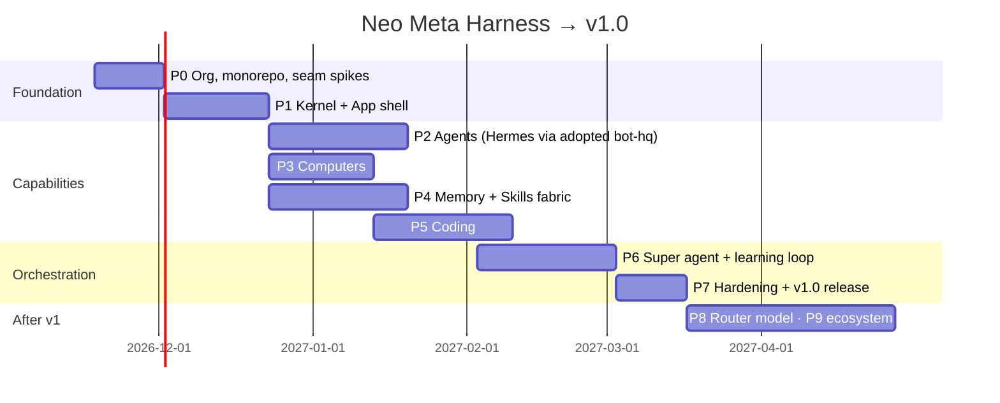

# 04 · Development Roadmap

Status: draft v0.2 · 2026-11-17 · supersedes v0.1 · Weeks from kickoff (2026-11-18), one core developer + coding agents

## P0: Foundation (weeks 1–2)
| ID | Task | Done when |
|---|---|---|
| P0-1 | Create org repos per [06](06-org-structure.md) with AGENTS.md, README, `machine/*.json`, templates, guardrails (≤ 20 writes per task, so batch it) | Repos exist; ROUTER.md complete |
| P0-2 | Product monorepo scaffold (pnpm + uv), local `pnpm check` pipeline | `pnpm check` green |
| P0-3 | **Seam spikes:** (a) T3 server driven by T3's headless `contracts` + `client-runtime` from a non-T3 React app; (b) Hermes `api_server` + dashboard backend API coverage for bots, cron, kanban, skills, memory, platforms, providers; (c) Hermes external-screen / computer-use seam; (d) DSH `computerUse` / `browserUse` provider + SDK JSON-RPC; (e) superagent custom Source + MCP in worker preset; (f) Hermes memory-provider plugin; (g) Astryx app in a Tauri 2 shell (Windows WebView2, macOS WKWebView, Linux WebKitGTK) + PWA, with the Node gateway as a sidecar; port the PandaCode streaming bench | Each works, or has a written fallback |
| P0-4 | Upstream registry + lock + `pnpm upstream:check` (local) | Lists drift for all engines |
| P0-5 | ADRs: kernel = Cordis, Neo API style, DB layer, auth model | Merged |

## P1: Kernel and App shell (weeks 3–5)
- Kernel: manifest, resolver, permissions, Cordis mount, process extensions (JSON-RPC/MCP), projections, health, toggle, blue/green upgrade.
- P1-10: a verified kernel-owned generation remains eligible to run when its bundled extension is absent.
- Neo API contracts and event bus; workspaces, members, roles; vault.
- P1-14: a deployment-level owner role, separate from the per-org `owner` role (decided 2026-11-21). Only the deployment owner sees and manages deployment-wide items (Hermes and channel bindings, kernel upgrades, org creation in server mode); in desktop mode the single user is the deployment owner.
- P1-15: the desktop gateway sidecar never outlives the shell (decided 2026-11-22). The shell owns it through the stdin pipe, and the gateway shuts down cleanly when that pipe closes (crash, kill or failed setup); server mode is unaffected. Desktop test cleanup no longer masks the real failure.
- `@neometaharness/ui` on Astryx + Neo theme (in NeoMetaHarness-design-system); slot runtime.
- App shell: navigation, Inbox placeholder, **Extensions** page, schema-driven Settings, onboarding skeleton; Tauri 2 desktop (tray, global launcher, updater, deep links) + PWA; perf budgets wired into `pnpm check`.
- **Exit:** install / enable / disable a sample TS and a sample Python extension live, without a restart.

## P2: Agents (weeks 6–9)
- `engine-hermes`: install / manage Hermes, profiles (many bots, one gateway), API mapping, vault projection.
- Adopt bot-hq into `packages/agents`: turn queue, steps UI, approvals, Library, rooms, `send_to_bot` ↔ `message_agent`.
- Routines = Hermes cron; tasks = Hermes kanban; delegation, goals, loops, insights, usage views.
- `channels` (all Hermes platforms; onboarding picker) and `models` (Model Hub, route roles, subscription sign-ins, **`models-router-panda`** with the escalation loop).
- Optional extensions: `voice-xai`, `apps-composio`, `x-search`.
- **Exit:** create 3 bots on different models; chat in the App and on Telegram + WhatsApp; routines and kanban work.

## P3: Computers (weeks 6–8, parallel)
- `neo.computers` interface + viewer (RFB/WebRTC) + leases (take over / hand back).
- Providers: `computer-hermes-screen`, `computer-local` (cua-driver), `computer-docker`, `computer-vnc`, `computer-orgo`, `computer-boat`.
- Safety baseline across providers; MCP projection into all engines.
- Projection into Hermes and DSH computer / browser seams.
- **Exit:** the same bot swaps between your desktop, a Docker desktop and Orgo with no code change.

## P4: Memory and Skills fabric (weeks 6–9, parallel)
- Local memory: MCP server, auth, provenance, trust levels, soul-file export; Hermes memory provider; DSH context plugin.
- Honcho self-hosted (`memory-honcho`), L1 ↔ L2 sync, dreaming + report, standing intents.
- P4-10: only workspace admins can add or change standing intents (decided 2026-11-21).
- Skill Registry (git-backed), Hermes skills sync, projections, eval gate, autonomy ceilings, rollback, Hub install with scan.
- App: Memory browser, SOUL / USER editor, Skills library / learn / curator / versions.
- **Exit:** `/learn` a procedure on a bot → it's versioned in the registry → a DSH session and another bot can use it.

## P5: Coding (weeks 9–12)
- `engine-t3`: manage the T3 server; `neo-coding` DSH profile as the default provider.
- Astryx Coding UI on T3's client runtime: projects, threads, composer, approvals, diff, checkpoints, worktrees, terminal, PR flow.
- DSH plugins: memory, soul, skills, report.
- **Exit:** build a feature end to end from the App (desktop and phone) with DSH, then switch the same thread to Claude Code.

## P6: Super agent and learning loop (weeks 12–15)
- `engine-superagent`: profile, Neo Sources (channel, cron, coding, agents, app, GitHub), worker MCP delegation, Policy from members' identities.
- Honcho for the super agent; Inbox in Astryx (approvals, questions, failures).
- Report / assessment contracts, accept modes + Suggestions, `@neo` comment and check Sources; ticket post-mortems + episodes → skills fabric; playbooks; decision logger (Panda-compatible trace format).
- Upstream drift checking via system cron `@neo/upstream check` creating admin Suggestions; `neo upstream` execution routine requiring a configured maintenance bot (`botId`) to run approved bumps.
- **Exit:** "build X and tell me on WhatsApp when the PR is up", "research Y every Monday on a bot's computer", and "remember Z" all work end to end and survive restarts.

## P7: Hardening and v1.0 (weeks 16–17)
- Toggle-safety test over all official extensions; security review (Security-Trust repo); backups and restore drill.
- Installers (Win / macOS / Linux, Docker Compose); docs site; onboarding under 15 minutes.
- P7-12: measure the PRD §6 success metrics from the running product (attention, learning, time to first value) and show them in the App (decided 2026-11-21).
- P7-13: fix the docs that disagree with the code (sweep of 2026-11-21; the code is the source of truth).
- P7-14: installers ship the Gateway runtime (production dependencies only, one shared flat node_modules) as a single archive that the desktop shell unpacks into the app data folder on first launch and after each update (decided 2026-11-22: loose files broke the Windows installer build on path length and bundling time). On-demand engine downloads are a later optimisation.
- P7-15: the desktop app shows a "Setting up Neo" screen while it unpacks the runtime archive (first launch and after an update), instead of showing nothing for tens of seconds.
- P7-16: the desktop app installs Hermes, the super agent and T3 on demand (decided 2026-11-23 after the v1.0.0 Windows install showed only DSH working: the other engines need the pinned upstream source cache, `uv`/Python or a running T3 server, none of which the installer ships). The installer bundles `uv`. Extensions shows Install for each engine; it downloads the engine's pinned ref from `upstream.lock.json` into the app data folder, verifies it against the lock, prepares it (Hermes venv, super agent build, T3 server) with progress, and reports failures in plain language. Engines stay unmodified; the dev `NMH_UPSTREAM_CACHE` path keeps working. Shipped as an update to v1.0.0.
- P7-17: the onboarding model step and Model Hub offer subscription sign-in (ChatGPT/Codex and Claude) through the sign-in flows Hermes and T3 already provide, stored in the vault and projected to every engine, next to the OpenAI-compatible API option (PRD APP-4, CM-2). Depends on P7-16.
- P7-18: premium UI/UX pass on Astryx (owner request 2026-11-25): one Neo theme on `@astryxdesign` tokens with light and dark modes (System, Light, Dark in Settings, no flash on load, desktop title bar follows), then every page polished to it (shell and navigation, onboarding, engines and extensions, chat, Coding, Inbox, Model Hub and Settings). Astryx only; contrast meets WCAG AA in both modes.
- P7-19: interactive agent UI with A2UI (owner request 2026-11-25): an `a2ui` extension renders A2UI messages from Hermes and T3 conversations as interactive UI mapped onto an Astryx widget catalog, and sends the user's actions back to the conversation. A2UI is pinned from ubermensch-site/a2ui-intrective-UI-for-chatbots (a fork of a2ui-project/a2ui) in the upstream registry; engines stay unmodified, and disabling the extension falls back to plain text.
- **v1.0 public release.**

## After v1
- **P8 Router model:** dataset from decision traces + Hermes trajectories; start from Panda Router (retrain its success head) for model choice; small model for Eval / delegation → shadow → canary → primary.
- **P9 Ecosystem:** extension registry site, signing, third-party SDK docs, cloud-sandbox computers (E2B, Daytona, appsandbox, box), browser computers (Steel, Browserless, BrowserHarness), native mobile, OIDC / SSO, hosted offering.

## Milestones
| M | Target | Meaning |
|---|---|---|
| M0 | 2026-12-01 | Org + monorepo + seams verified |
| M1 | 2026-12-22 | Extensions toggle live in an Astryx App |
| M2 | 2027-01-19 | Agents on any channel, model and computer |
| M3 | 2027-01-26 | Shared memory + learned skills across engines |
| M4 | 2027-02-09 | Coding in Neo App |
| M5 | 2027-03-09 | Super agent orchestrates and learns |
| **v1.0** | **2027-03-23** | Public release |
